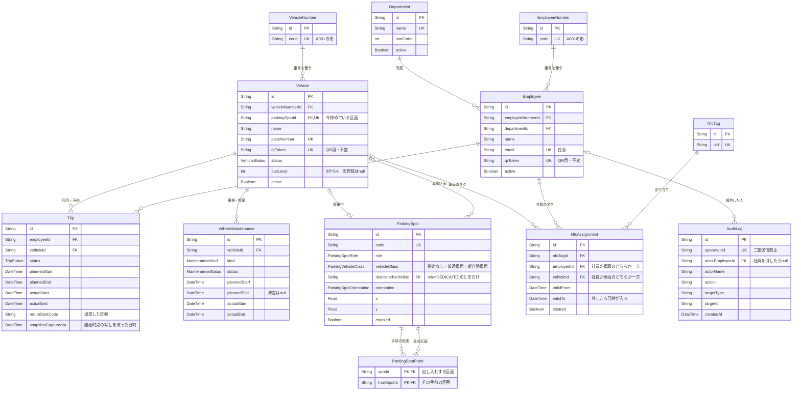
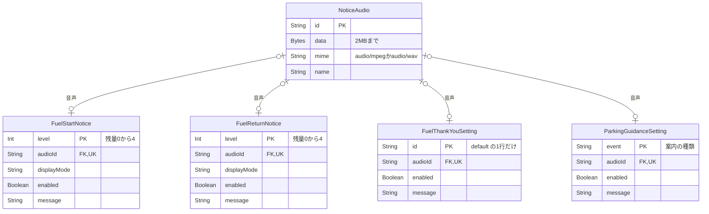

# ER図

DBの表と関係を図にしたものです。定義の正本は`prisma/schema.prisma`と`prisma/migrations`の移行SQLで、各表の内容は[仕様書の「8. データモデル」](仕様書.md#8-データモデル)にあります。表や関係を変えたら、この図も直してください。

- 図はMermaidで書いています。GitHubやVS Code（Mermaid対応の拡張機能）でそのまま図として表示されます。
- 項目は主キー・外部キー・一意項目と、関係を読むのに必要なものだけを載せています。`createdAt`、`updatedAt`、`version`（楽観的ロック）などは省いています。
- 線の記号は、`||`が「必ず1」、`|o`が「0か1」、`o{`が「0以上」を表します。

## 1. 社員・車両・駐車場・利用

## 2. 案内・お礼の設定と音声

ほかの表とはつながっていない、設定だけの表です。音声は`NoticeAudio`にまとめ、各設定から1件ずつ参照します。

## 3. 図に表れない制約

関係の読み方に効く制約です。移行SQLのCHECK制約・部分一意索引で守っています。

| 対象 | 制約 |
| --- | --- |
| `Vehicle.parkingSpotId` | 一意。1区画に停められる車は1台 |
| `ParkingSpot.dedicatedVehicleId` | `role`が`DEDICATED`のときだけ値が入り、それ以外はnull |
| `ParkingSpot.vehicleClass` | `ANY`（指定なし）・`STANDARD`（普通車用）・`KEI`（軽自動車用）。専用区画の制限とは別の推奨値 |
| `ParkingSpotFront` | 自分自身を手前の区画にできない。区画を消すと一緒に消える |
| `NfcAssignment` | `employeeId`と`vehicleId`はどちらか一方だけに値が入る。有効な割り当て（`validTo`がnull）は、タグ・社員・車両ごとに1件まで |
| `Employee`、`Vehicle` | 有効なもの（`active`がtrue）の中で、同じ社員番号・車両番号は1件まで |
| `Trip` | 利用中（`IN_USE`）は車両ごと・社員ごとに1件まで。状態と実績日時の組み合わせが合っていること |
| `VehicleMaintenance` | 整備中（`ACTIVE`）は車両ごとに1件まで |
| `AuditLog` | 社員を消しても履歴は残し、`actorEmployeeId`をnullにする。名前は`actorName`に残る |
| 各案内の`audioId` | 一意。音声を消すと参照はnullになる |
